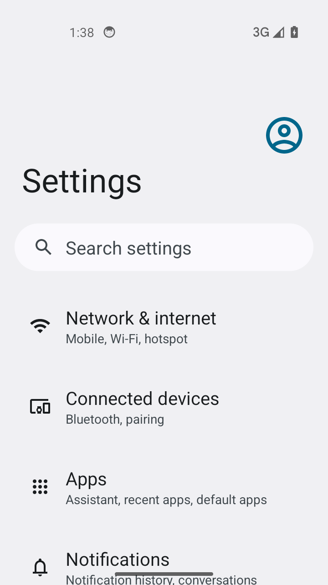
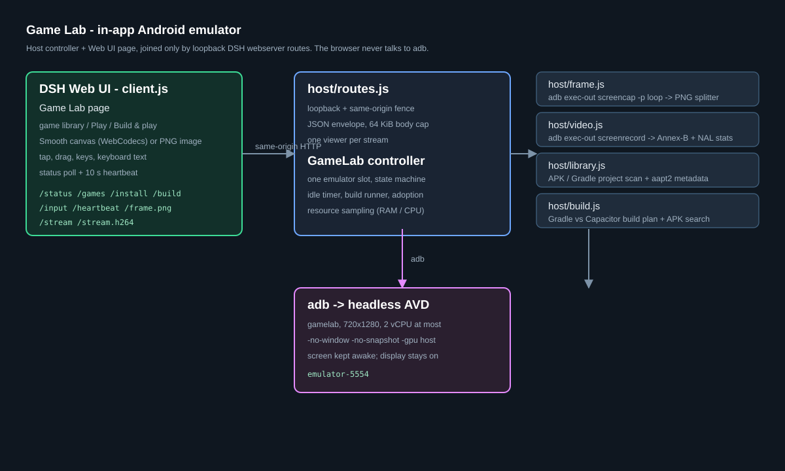

# DSH InApp Plugin — Game Lab

**An Android emulator that lives inside [DeepSeek Harness](https://github.com/deepseek-ai/deepseek-harness): boot it on demand, install the game you are building, play it in the page, and let it shut itself down again.**

Game Lab is a DSH plugin (host + Web UI) that turns an ordinary Android SDK
emulator into an in-app test bench. It was built for the loop *"change the
game, build it, see it on a device"* without installing MEmu/LDPlayer/BlueStacks
or keeping a second emulator window around.



## Why

A separate Android emulator costs multiple GB of storage and, once open, a
large slice of RAM/CPU even when you are not testing. Game Lab uses the
Android SDK emulator tooling that is already on the machine, boots one lean
headless AVD only when asked, streams only while the page is watching, and
stops itself after an idle period.

## Features

- **On-demand headless AVD** — 720x1280, up to 2 vCPU, host GPU, no window,
  no snapshots. Auto-created from an installed x86_64 system image the first
  time the configured AVD does not exist.
- **Smooth live view** — H.264 from the emulator's encoder, decoded with
  **WebCodecs** on a canvas (measured ~19 fps while content changes). Falls
  back to the PNG multipart stream (about 1 fps) automatically if WebCodecs is
  unavailable; a **Smooth/Compat** toggle is in the toolbar.
- **Real touch input** — tap, drag/swipe, Back/Home/Recents, rotation, hardware
  keys, plus a **Keyboard** panel for ASCII text and Enter/Space/Backspace/Esc.
- **Game library** — scans your folders for APKs, groups builds by name
  (newest first, older builds collapsible), and lists Gradle/Capacitor game
  projects. **Play** installs and launches an APK.
- **Build & play** — detects the project type and runs the right pipeline:
  plain Gradle (`gradlew assembleDebug`) or Capacitor
  (`npm run android:apk`, or `npm run build` + `npx cap sync android` +
  Gradle). The newest APK is installed and launched; `/status` reports the
  current phase.
- **Low idle footprint** — the PNG/H.264 loops stop when nobody is watching;
  the emulator stops after 5 idle minutes (configurable), and a running build
  is never interrupted by the idle timer. The display is kept awake while it
  runs so games don't freeze behind a lock screen.
- **Diagnostics** — live fps/RAM/CPU, logcat tail, one-click screenshot, and a
  status API.

## Quick start

Requirements: DSH with the Web UI, Android SDK (`ANDROID_HOME` or
`ANDROID_SDK_ROOT`), an x86_64 system image, and (for Build & Play) a JDK plus
Node/npm for Capacitor projects. Windows is the tested platform; the host code
has POSIX branches but is not exercised on macOS/Linux yet.

```text
# Ask your DSH agent to install this local folder as a bundle.
# `plugin_manager` is a DSH agent tool, not a shell command.
plugin_manager install_bundle target: <absolute path to this clone>
```

The agent tool links the folder into the profile, adds it to the bundle
selection and activates it live. If you prefer to wire a profile by hand, see
[docs/INSTALL.md](docs/INSTALL.md).

Then:

1. Reload the Harness page so the client half loads.
2. Click the **Game Lab** gamepad icon in the left sidebar.
3. Press **Start emulator** (~40-60 s cold boot).
4. Point `gameRoots` at your games (see [Configuration](docs/CONFIGURATION.md)),
   press **Play** (or **Build & play**), and use the toolbar to interact.

## How it works

```
DSH Web UI page (client.js)
      │  fetch/stream: /status /games /frame.png /stream /stream.h264 /input
      ▼
DSH webserver route (host/routes.js) — loopback + same-origin fence
      ▼
GameLab controller (host/emulator.js)
      ├── frame.js     persistent `adb exec-out screencap -p` → PNG parts
      ├── video.js     persistent `adb exec-out screenrecord … -` → H.264
      ├── library.js   APK/Gradle-project scanner (aapt2 metadata lazily)
      ├── build.js     Gradle / Capacitor build-plan detection + APK search
      └── adb ▸ headless AVD (gamelab)
```

Deep dives: [Architecture](docs/ARCHITECTURE.md) ·
[API](docs/API.md) · [Configuration](docs/CONFIGURATION.md) ·
[Development](docs/DEVELOPMENT.md) · [Verification](docs/VERIFICATION.md) ·
[Troubleshooting](docs/TROUBLESHOOTING.md) · [Roadmap](docs/ROADMAP.md).



## Measured on the development machine (2026-11-05)

| fact | value |
|---|---|
| cold boot to usable Android | 36-62 s |
| emulator host memory while running | ~3.1-3.7 GB (API 34 image floor) |
| emulator host CPU while streaming | ~2.1-2.4 cores |
| smooth H.264 view | ~19 fps while the screen changes; ~0.1-1.0 Mbps |
| compatibility PNG view | ~0.7-1.6 fps |
| tap round trip | ~0.7 s |
| install + launch a 9.6 MB APK | 3.7 s |
| Capacitor Build & Play (web build + cap sync + Gradle) | 71.4 s from emulator-off |
| idle auto-stop | fires after 5 min; RAM returns to the OS |

The full evidence, including what was **not** verified, is in
[docs/VERIFICATION.md](docs/VERIFICATION.md).

## Repository layout

```
client.js            Web UI page + sidebar icon (plain-JS React)
index.js             host entry point
host/
  emulator.js        controller: AVD lifecycle, adb, input, install, build
  frame.js           PNG frame pipeline (multipart stream)
  video.js           H.264 screenrecord loop + NAL statistics
  build.js           Gradle/Capacitor build-plan detection
  library.js         APK/project scanner, grouping, aapt2 metadata
  routes.js          /_dsh/game-lab/* routes and security fence
locale/              Plugin Manager metadata (en, zh)
test/                node --test suites
docs/                architecture, install, config, API, development, verification
assets/              icon and screenshots
```

## Configuration

See [docs/CONFIGURATION.md](docs/CONFIGURATION.md). The short version: edit the
`game-lab` row in your profile's `cordis.patch.yml` (or override the bundle
defaults) and change `gameRoots`, `avdName`, `idleMinutes`, `ramMb`, `cores`,
`gpuMode`, or `maxFps`. The bundle ships with `gameRoots: [C:\Games]` as an
example.

## Limitations

- Smooth view frame rate follows **screen changes**: static menus can update
  only a few times per second while moving games reach ~10-20 fps.
- The emulator needs ~3.5 GB of RAM while running (Android 14 system image
  minimum plus QEMU); the plugin minimizes *when* that cost is paid, not the
  cost itself. A lighter system image/AVD is the lever.
- ASCII text only unless ADBKeyboard is installed in the AVD.
- One emulator and one live-video viewer at a time.
- Windows is the tested host; the plugin is not yet validated on macOS/Linux.

## License

[MIT](LICENSE) © 2026 Xianwuli (LordGrimTaken)
